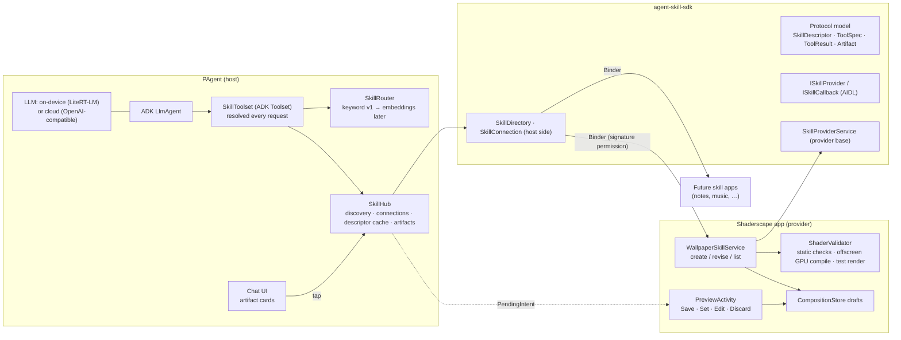

# Architecture: Agent Skills

## Why skills live in separate apps
- An agent will gain many capabilities. Compiling each one into the agent app would make the agent:
  - host every capability's services (a live wallpaper service, GL threads, storage, UI);
  - ship every capability on its own release cycle;
  - crash along with any of them.
- So capabilities live in **skill-provider apps**, and the agent discovers them at runtime.
- AppFunctions have the right shape (self-describing functions in the provider app). However, calling another app's functions needs `EXECUTE_APP_FUNCTIONS`, which is limited to privileged agents. So v1 uses the same shape over our own Binder contract, and an AppFunctions adapter can come later.

## Responsibilities

| Piece | Owns |
|---|---|
| **SDK** | Wire protocol, AIDL, the provider base class (threading, errors, cancellation), host-side discovery and binding, artifact state, the signature permission |
| **Host (PAgent)** | Which skills reach the model (routing), turning tool specs into ADK tools, risk policy, showing artifacts and storing their ids in chat history |
| **Provider (Shaderscape)** | Tool semantics, validation, its own data, and the UI where the user makes decisions |

## Prompt budget and routing
Every tool and instruction costs tokens on each request, and small models choose worse among many tools. So:
- `SkillToolset.getTools()` asks the `SkillRouter` for the skills relevant to the latest user message.
- **v1 (`KeywordSkillRouter`)** offers everything while the total is ≤ 6 tools. Otherwise it offers skills whose keywords or summary words match, plus skills already used in the session (so "make it bluer" still works).
- Instructions are added through `processLlmRequest`, **only for the selected skills**.
- **Next:** embedding-based routing, or a two-stage pick where the model first chooses a skill and then sees its tools.

## Human in the loop
- Providers return **drafts plus an artifact** instead of acting.
- The user decides in the provider's own UI. In this case, `PreviewActivity` offers Save, Set as wallpaper, Edit layers and Discard.
- The host blocks `SIDE_EFFECT` tools until it has a confirmation flow.

## Shader generation quality
- The model writes free-form GLSL. The provider makes this robust in three ways:
  1. `ShaderTidier` silently fixes formatting mistakes (fences, `#version`, `precision`, redeclared uniforms).
  2. `ShaderValidator` compiles on an offscreen GPU context using the **same header, footer and renderer as the live wallpaper**. Errors come back with the author's line numbers, plus warnings for slow or flat output.
  3. The model retries up to 3 times in a row per caller, guided by `next_step` in the result.
- **Model choice:**
  - Gemma E2B will often need repairs.
  - Gemma E4B is better.
  - Cloud models (OpenRouter, Ollama Cloud, OpenAI, Gemini, any OpenAI-compatible endpoint) are best. PAgent plugs them in at ADK's `Model` interface, so the skill works unchanged.
- `ShaderValidator` can also serve as an eval harness: compile rate, render sanity and frame time over a prompt set.

## Artifacts across restarts
- A `PendingIntent` dies with the host process, but the artifact **id** survives: PAgent stores `{id, title, kind, skill}` in the tool response, so it's part of the saved chat history.
- When a chat is reopened (or the app resumes), the host calls `resolveArtifact(id)` on the provider that made it.
- The provider answers with an `ArtifactState`: **pending**, **saved** or **gone**, a short label, and a fresh `Artifact` (new PendingIntent) while it can still be opened.
- The card shows that state. Tapping a pending or saved card opens it, and a gone card says so. A provider that doesn't override `onResolveArtifact` returns null, and the card shows as unavailable.
- `resolveArtifact` was **appended** to the AIDL interface, so older hosts and providers keep working. New methods must always be appended.

## Distribution
- The SDK is its own repo, published through JitPack from git tags: `com.github.PhaniKiran1999:agent-skill-sdk:<tag>`.
- Apps set `useLocalSkillSdk=true` in `local.properties` to build against a local checkout instead (Gradle composite build with dependency substitution).

## Roadmap
- **Transports:** A2A for cloud agents (PAgent's `RemoteAgentGateway`), and an AppFunctions adapter if the permission opens up.
- **Trust:** a third-party trust model (allow-list, per-skill user consent) beyond same-signature apps.
- **Side effects:** a confirmation UI for `SIDE_EFFECT` tools.
- **Routing:** embeddings or a two-stage pick, once there are many skills.
