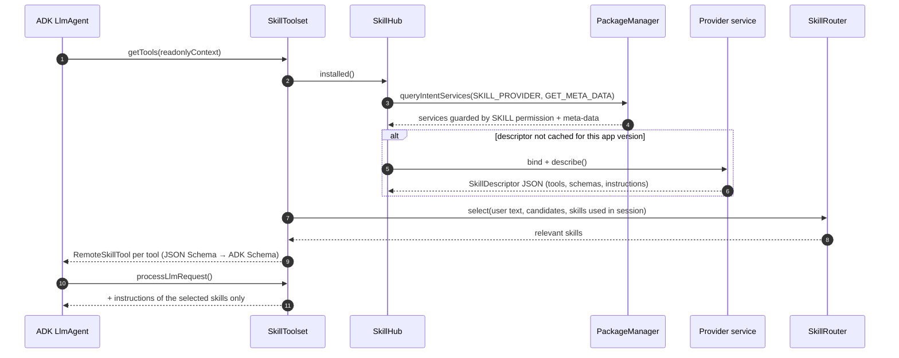
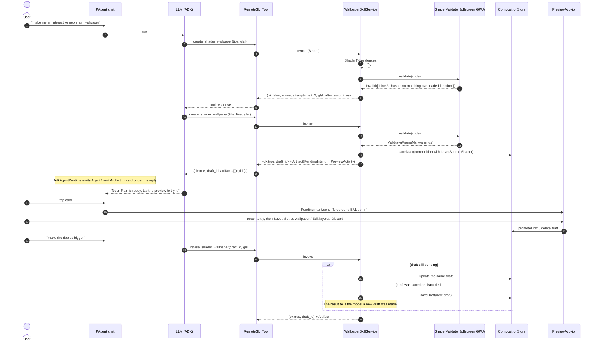
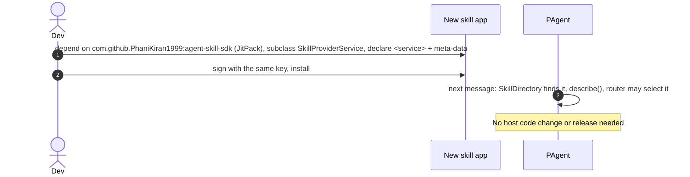
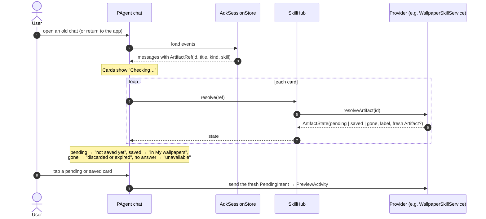

# Sequence Flows

## 1. Discovery and routing (every model request)

## 2. Create → validate → repair → preview → decide

## 3. Install a new skill app

## 4. Reopening an old chat (artifact state)

